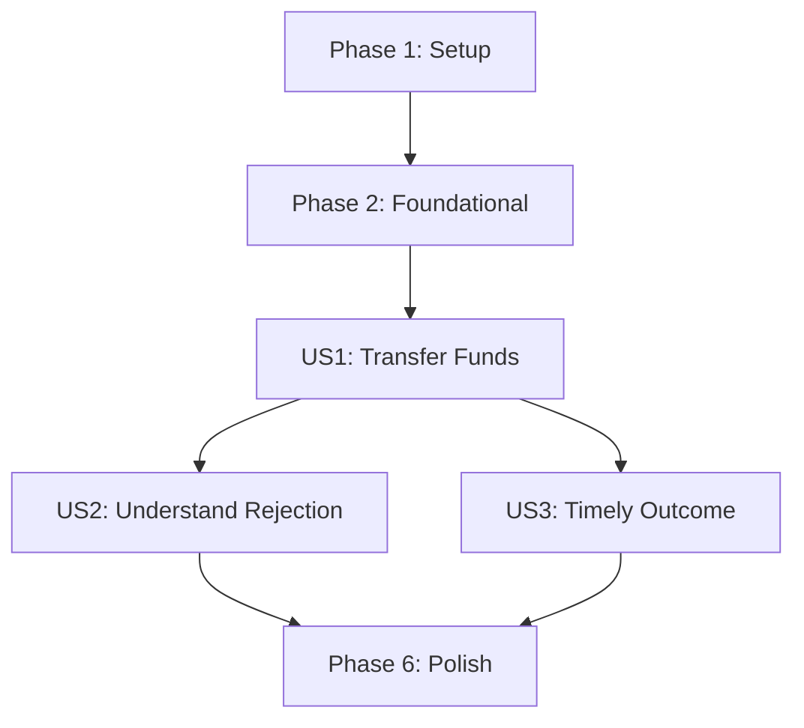

# Tasks: Fund Transfer

**Input**: Design documents from `specs/001-fund-transfer/`

**Prerequisites**: `plan.md`, `spec.md`, `research.md`, `data-model.md`, `contracts/transfers-api.md`, `quickstart.md`

**Tests**: Included because the project constitution requires automated tests for every product and security rule.

**Organization**: Tasks are grouped by user story. Completed tasks from the original transfer implementation remain checked; tasks added for the account-age limit are unchecked and dependency-ordered.

## Phase 1: Setup

**Purpose**: Initialize the Python API and constitution-required React/Vite client.

- [X] T001 [P] Declare Python `>=3.12`, FastAPI, Pydantic, SQLAlchemy, psycopg, and pytest dependencies in `apps/api/pyproject.toml`.
- [X] T002 [P] Scaffold the React/Vite client with its package scripts and entry point in `apps/web/package.json`, `apps/web/vite.config.ts`, and `apps/web/src/main.tsx`.
- [X] T003 Generate and verify the uv lockfile at `apps/api/uv.lock` from `apps/api/pyproject.toml`.

---

## Phase 2: Foundational

**Purpose**: Establish configuration, persistence, identity, and service boundaries required by every story.

**Checkpoint**: Complete this phase before implementing user stories.

- [X] T004 Configure API settings and PostgreSQL session lifecycle using synthetic environment placeholders in `apps/api/src/simple_bank/settings.py`, `apps/api/src/simple_bank/persistence/database.py`, and `.env.example`.
- [X] T005 Create the SQLAlchemy `Account` model in `apps/api/src/simple_bank/persistence/models/account.py` with the data-model constraints: `account_number` is "Unique; retain as text to preserve leading zeroes" and "Mask as `XXXX` plus the last four digits whenever displayed; never log the full value"; `customer_id` "Identifies the owning customer. The sender account must belong to the authenticated customer"; `balance` is "Rs balance at two decimal places; must not become negative as a result of a transfer"; `status` is "`ACTIVE` or `INACTIVE`; both sender and recipient must be active"; `account_type` is "Sender must be `SAVINGS`; recipient account type is not otherwise restricted by the spec".
- [X] T006 Create the SQLAlchemy `Transaction` model in `apps/api/src/simple_bank/persistence/models/transaction.py` with these data-model constraints: `transaction_id` is "Unique and assigned to an accepted transaction"; `customer_id` is "Derived from the trusted authenticated context; used with `request_id` for uniqueness"; `request_id` is "Unique per customer for an accepted transfer; same ID and same transfer details returns the original result"; `from_account` is "Required; savings account owned by the authenticated customer"; `to_account` is "Required; must identify a different active Simple Bank account"; `amount` is "Positive Rs amount represented to two decimal places"; `status` is "`ACCEPTED`; rejected submissions are not stored"; `created_at` is "Set when the transfer is accepted; serialize as ISO 8601 with offset".
- [X] T007 Create the initial PostgreSQL migration in `apps/api/migrations/versions/001_transfer_schema.sql`, including foreign keys, exact two-decimal numeric balances/amounts, active-status checks, accepted-transaction status, and a customer-scoped unique constraint for `request_id`.
- [X] T008 Define authenticated customer context and the injectable per-transfer `TransferVerifier` interface in `apps/api/src/simple_bank/security/context.py` and `apps/api/src/simple_bank/security/verification.py`; add a synthetic verifier fixture in `apps/api/tests/conftest.py`.
- [X] T009 Define typed transfer-rule errors, the `TransferRepository` interface, and unit-of-work boundary in `apps/api/src/simple_bank/domain/transfer_repository.py` and `apps/api/src/simple_bank/persistence/unit_of_work.py`.
- [X] T010 Create the FastAPI application factory and account-number-safe logging defaults in `apps/api/src/simple_bank/api/app.py` and `apps/api/src/simple_bank/api/logging.py`.

---

## Phase 3: User Story 1 - Transfer Funds (Priority: P1) - MVP

**Goal**: A customer submits a verified, eligible transfer and receives confirmation after both balances and the transaction record commit.

**Independent Test**: With synthetic active accounts, a valid verification proof, and sufficient balance, submit `POST /api/v1/transfers`; verify an accepted response, one saved transaction, and equal debit/credit amounts.

### Tests for User Story 1

- [X] T011 [P] [US1] Add `TransferService` unit tests for an eligible transfer, positive two-decimal amount, saved transaction ID, and equal sender debit/recipient credit in `apps/api/tests/unit/test_transfer_service.py`.
- [X] T012 [P] [US1] Add idempotency unit tests proving an accepted retry with the same customer, request ID, sender, recipient, and amount returns the original response, while changed transfer details yield `REQUEST_ID_CONFLICT`, in `apps/api/tests/unit/test_transfer_idempotency.py`.
- [X] T013 [P] [US1] Add PostgreSQL integration tests proving transaction persistence and both balance changes commit or roll back together in `apps/api/tests/integration/test_transfer_atomicity.py`.
- [X] T014 [P] [US1] Add a client test for submitting a transfer and displaying the accepted transaction ID in `apps/web/src/features/transfers/TransferForm.test.tsx`.
### Implementation for User Story 1

- [X] T015 [P] [US1] Implement the independently testable `TransferService` in `apps/api/src/simple_bank/services/transfer_service.py`; validate sender ownership and savings type, positive amount, sufficient balance, customer IST daily limit, different active accounts, and per-transfer verification; handle request-ID replay/conflict; delegate atomic persistence through injected interfaces without importing FastAPI or accessing the database directly.
- [X] T016 [P] [US1] Implement PostgreSQL transfer persistence in `apps/api/src/simple_bank/persistence/transfer_repository.py`, including customer/account row locking, India Standard Time daily-total calculation, unique request-ID lookup, and one transaction for the saved record plus both balance updates.
- [X] T017 [US1] Define Pydantic request and response schemas for `request_id`, `verification_proof`, `from_account`, `to_account`, `amount`, and accepted response fields in `apps/api/src/simple_bank/api/schemas/transfers.py`.
- [X] T018 [US1] Expose `POST /api/v1/transfers` through a thin FastAPI route that obtains authenticated customer context and delegates to `TransferService` in `apps/api/src/simple_bank/api/routes/transfers.py`.
- [X] T019 [US1] Implement the `/api/v1` transfer client and customer transfer form for account selection, amount entry, request ID, verification proof, and accepted outcome in `apps/web/src/lib/api/transfers.ts` and `apps/web/src/features/transfers/TransferForm.tsx`.

**Checkpoint**: The eligible verified transfer path works independently and preserves the all-or-nothing balance and transaction invariant.

---

## Phase 4: User Story 2 - Understand a Rejected Transfer (Priority: P1)

**Goal**: A customer sees a clear rejection reason when a transfer violates a rule, with no transaction or balance changes.

**Independent Test**: Submit one synthetic request per documented rejection code and verify the returned code/message and unchanged account balances and transaction records.

### Tests for User Story 2

- [X] T020 [P] [US2] Add `TransferService` unit tests for `INVALID_AMOUNT`, `INSUFFICIENT_BALANCE`, `DAILY_LIMIT_EXCEEDED`, `SAME_ACCOUNT`, `ACCOUNT_INACTIVE`, `REQUEST_ID_CONFLICT`, and `VERIFICATION_REQUIRED` in `apps/api/tests/unit/test_transfer_rejections.py`.
- [X] T021 [P] [US2] Add API contract tests for rejection codes, HTTP status mapping, account ownership/savings authorization, masked output, and absence of balance or transaction changes in `apps/api/tests/api/test_transfer_errors.py`.
### Implementation for User Story 2

- [X] T022 [US2] Map domain rejection results to the documented API error codes and HTTP statuses in `apps/api/src/simple_bank/api/error_mapping.py`; return a generic HTTP 403 `FORBIDDEN` for sender-ownership or savings-account authorization failures without revealing whether an account exists, and document that response in `specs/001-fund-transfer/contracts/transfers-api.md`.
- [X] T023 [US2] Display the safe human-readable rejection message for each API error code without showing full account numbers in `apps/web/src/features/transfers/TransferForm.tsx`.
- [X] T024 [US2] Add PostgreSQL integration tests for rejected transfers proving each rule leaves balances and saved transactions unchanged in `apps/api/tests/integration/test_transfer_rejections.py`.

**Checkpoint**: Each documented invalid transfer receives its expected rejection, and no rejected attempt is represented as a completed transfer.

---

## Phase 5: User Story 3 - Receive a Timely Outcome (Priority: P2)

**Goal**: The customer sees an accepted or rejected outcome within one second, including a safe retry path when the response is uncertain.

**Independent Test**: Measure submission-to-visible-result time in the controlled local stack and verify retry after a simulated lost response does not apply the transfer twice.

### Tests for User Story 3

- [X] T025 [P] [US3] Add a PostgreSQL-backed API latency test asserting a customer-visible accepted or rejected response within one second using the synthetic verifier in `apps/api/tests/integration/test_transfer_latency.py`.
- [X] T026 [P] [US3] Add client tests for pending, accepted, rejected, and uncertain-network states, verifying the same request ID is retained for retry in `apps/web/src/features/transfers/TransferResponse.test.tsx`.
### Implementation for User Story 3

- [X] T027 [US3] Keep the transfer request pending until its final server outcome, show the outcome promptly, and retain request ID plus transfer details for a safe retry after an uncertain network result in `apps/web/src/features/transfers/TransferForm.tsx` and `apps/web/src/lib/api/transfers.ts`.
**Checkpoint**: The accepted/rejected result is visible within one second in the controlled test setup; retried accepted requests do not change balances a second time.

---

## Phase 6: Polish & Cross-Cutting Concerns

**Purpose**: Complete constitutional security checks and verify the end-to-end implementation guide.

- [X] T028 [P] Add tests that API output masks account numbers and logs never contain full account numbers in `apps/api/tests/api/test_account_masking.py`.
- [X] T029 [P] Add a web boundary test proving transfer UI calls only `/api/v1` and has no direct persistence access in `apps/web/tests/api_boundary.test.ts`.

---

## Remaining Work: Account-Age Daily Transfer Limits

**Purpose**: Extend the completed transfer workflow to enforce the newly specified age-based, per-sending-account daily caps.

### User Story 1 - Transfer Funds (Priority: P1)

**Independent Test**: Accept an amount that reaches the correct account-age cap, reject an amount that exceeds it, and verify the exact 30×24-hour boundary, separate account totals, IST reset, and legacy-account backfill.

#### Tests

- [ ] T030 [P] [US1] Add `TransferService` tests for the Rs 50,000 cap before 30×24 hours, the Rs 1,00,000 cap at and after 30×24 hours, exact-cap acceptance, over-cap rejection, and the threshold instant in `apps/api/tests/unit/test_transfer_rejections.py`.
- [ ] T031 [P] [US1] Add PostgreSQL-backed tests proving same-day totals are isolated by sending account and reset at IST midnight, and concurrent transfers cannot exceed the sending account's applicable cap in `apps/api/tests/integration/test_transfer_daily_limits.py`.
- [ ] T032 [P] [US1] Add a migration test proving pre-existing accounts are backfilled as at least 30×24 hours old and retain the Rs 1,00,000 cap in `apps/api/tests/integration/test_account_opening_time_migration.py`.
- [ ] T033 [P] [US1] Add a synthetic registration test proving a newly registered account's `opened_at` equals its actual registration instant in `apps/api/tests/api/test_sqlite_development.py`.

#### Implementation

- [ ] T034 [P] [US1] Add the account's time-zone-aware opening instant to `AccountSnapshot` and change the daily-total repository contract to accept a sending-account identifier in `apps/api/src/simple_bank/domain/transfer_repository.py`.
- [ ] T035 [P] [US1] Add non-null, time-zone-aware `opened_at` to `apps/api/src/simple_bank/persistence/models/account.py` and create `apps/api/migrations/versions/004_account_opening_time.sql`; backfill legacy rows to at least 30×24 hours before migration completion before enforcing `NOT NULL`.
- [ ] T036 [US1] Set `opened_at` to the actual registration instant when `SqlAlchemyAuthRepository.register_customer` creates a new account in `apps/api/src/simple_bank/persistence/auth_repository.py` (depends on T035).
- [ ] T037 [US1] Return `opened_at` in SQLAlchemy account snapshots and sum only accepted transactions for the specified sender account within the supplied IST-day UTC bounds in `apps/api/src/simple_bank/persistence/transfer_repository.py` (depends on T034 and T035).
- [ ] T038 [US1] Update the `MemoryTransferRepository` and synthetic PostgreSQL account fixtures to provide opening instants, and aggregate in-memory accepted daily amounts by sending account in `apps/api/tests/conftest.py` (depends on T034 and T035).
- [ ] T039 [US1] Select the Rs 50,000 cap when the elapsed sender-account age is less than 30×24 hours and Rs 1,00,000 otherwise; evaluate age at transfer time and apply the sender-account daily total in `apps/api/src/simple_bank/services/transfer_service.py` (depends on T034, T037, and T038).

### User Story 2 - Understand a Rejected Transfer (Priority: P1)

**Independent Test**: Submit a synthetic over-cap transfer; verify `DAILY_LIMIT_EXCEEDED`, no transaction identifier or balance changes, and accurate UI guidance for both caps.

#### Tests

- [ ] T040 [P] [US2] Extend the API contract test to verify an age-based over-limit request returns `DAILY_LIMIT_EXCEEDED`, has no transaction identifier, and changes neither account balance in `apps/api/tests/api/test_transfer_errors.py` (depends on T039).
- [ ] T041 [P] [US2] Test that the transfer form explains both age-based caps and per-sending-account aggregation, and displays the API's rejection message in `apps/web/src/features/transfers/TransferForm.test.tsx`.

#### Implementation

- [ ] T042 [US2] Replace the fixed Rs 1,00,000 UI limit claim with guidance explaining the Rs 50,000 cap before 30×24 hours, the Rs 1,00,000 cap at or after that age, and per-sending-account totals in `apps/web/src/features/transfers/TransferForm.tsx`; keep the server authoritative and do not accept a client-selected cap or account age (depends on T041).

### User Story 3 - Receive a Timely Outcome (Priority: P2)

**Independent Test**: Measure accepted and age-based rejected API responses in the PostgreSQL-backed test setup; each outcome must arrive in less than one second.

- [ ] T043 [US3] Extend the PostgreSQL-backed latency test to measure an age-based rejected outcome as well as an accepted outcome; each API result must take less than one second in `apps/api/tests/integration/test_transfer_latency.py` (depends on T039).

### Final Validation

- [ ] T044 Run the backend unit/API/integration tests, frontend tests and build, and the age-boundary, per-account, IST-reset, legacy-backfill, new-account, and latency scenarios; update verified commands and expected outcomes in `specs/001-fund-transfer/quickstart.md` and `README.md` (depends on T039-T043).

---

## Dependencies & Execution Order

### Phase Dependencies

- **Setup (Phase 1)**: No dependencies. API and web scaffolding tasks can run in parallel; the uv lock task follows the API dependency declaration.
- **Foundational (Phase 2)**: Depends on setup and blocks all user stories. Models precede migrations and persistence use; authentication/verifier and repository interfaces must exist before service implementation.
- **User Story 1 (Phase 3)**: Depends on foundational work and delivers the accepted transfer path plus the account-age limit. Its cap, migration, and registration tests (T030-T033) precede implementation (T034-T039).
- **User Story 2 (Phase 4)**: Depends on US1's age-based backend behavior; adds API rejection coverage and accurate customer-facing limit guidance.
- **User Story 3 (Phase 5)**: Depends on US1's age-based backend behavior to validate the accepted and rejected response-time target.
- **Polish (Phase 6)**: Depends on all stories selected for release.

### User Story Dependencies



### Parallel Opportunities

- Setup: T001 and T002 can run in parallel; T003 follows T001.
- Foundational: T005 and T008 can run in parallel after T004; T006 follows T005; T007 follows T005 and T006.
- US1: T030-T033 touch separate test files and can be authored in parallel. T034 and T035 touch separate domain/schema files and can proceed in parallel after the tests are in place; after both complete, T036-T038 touch separate files and can also proceed in parallel.
- US2: T040 and T041 touch separate API and frontend test files and can be developed in parallel after T039; T042 follows T041.
- US3: T043 can be completed independently of US2 after T039.
- Polish: T044 follows the age-limit implementation, rejection guidance, and latency validation.

## Parallel Examples

### User Story 1

```text
T011 TransferService success tests: apps/api/tests/unit/test_transfer_service.py
T012 Idempotency tests: apps/api/tests/unit/test_transfer_idempotency.py
T013 Atomicity tests: apps/api/tests/integration/test_transfer_atomicity.py
T014 Accepted client-flow test: apps/web/src/features/transfers/TransferForm.test.tsx

For the age-based cap, author T030-T033 in parallel across their separate test files.
Then complete T034-T039 in dependency order for the domain contract, schema/backfill,
account registration timestamp, per-account query, fixtures, and service rule.
```

### User Story 2

```text
T020 Service rejection tests: apps/api/tests/unit/test_transfer_rejections.py
T021 API error contract tests: apps/api/tests/api/test_transfer_errors.py
T040 Age-based API rejection contract: apps/api/tests/api/test_transfer_errors.py
T041 Cap guidance and rejection-display test: apps/web/src/features/transfers/TransferForm.test.tsx
```

### User Story 3

```text
T025 API latency test: apps/api/tests/integration/test_transfer_latency.py
T026 Client pending/retry tests: apps/web/src/features/transfers/TransferResponse.test.tsx
T043 Age-based rejected-response latency assertion: apps/api/tests/integration/test_transfer_latency.py
```

## Implementation Strategy

### MVP and Release Scope

The first demonstrable increment is US1. Because both US1 and US2 are P1 and rejection safety is essential for financial correctness, do not release transfers until US2 is complete. US3's one-second outcome requirement and Phase 6 checks are also release gates.

### Incremental Delivery

1. Existing setup and foundational phases are complete.
2. Add the account-age, per-account aggregation, migration, and registration tests; implement and independently validate US1.
3. Add US2's age-based API rejection coverage and accurate cap guidance.
4. Complete US3's accepted and rejected response-time validation.
5. Run the full quickstart and constitutional checks before release.

## Format Validation

- Every task uses a checkbox, sequential task ID, optional parallel marker, required user-story label in story phases, and at least one concrete file path; completed legacy tasks retain their checked state.
- Tests are included to satisfy the constitution's automated-test requirement for every rule.