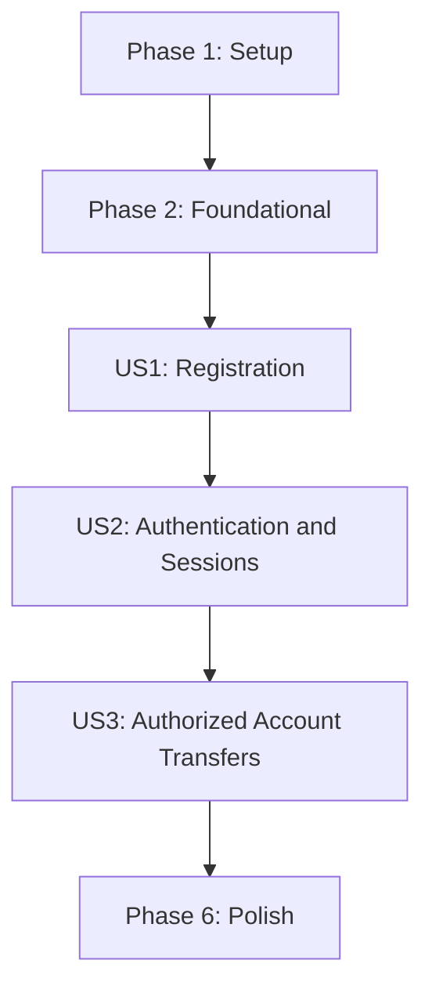

# Tasks: Customer Authentication and Account Onboarding

**Input**: Design documents from `specs/002-account-auth-onboarding/`

**Prerequisites**: `plan.md`, `spec.md`, `research.md`, `data-model.md`, `contracts/auth-api.md`, `quickstart.md`

**Tests**: Included because the constitution requires automated tests for every product, security, API, and account-data rule.

**Organization**: Tasks are grouped by user story. Tests for each story precede that story's implementation tasks.

---

## Phase 1: Setup

**Purpose**: Add the selected security and contact-validation dependencies to the existing API project.

- [ ] T001 Add `argon2-cffi` for Argon2id password hashing and `phonenumbers` for E.164 input validation to `apps/api/pyproject.toml`.
- [ ] T002 Regenerate and verify the Python 3.12 uv lockfile after dependency changes in `apps/api/uv.lock`.

---

## Phase 2: Foundational

**Purpose**: Establish shared auth contracts, composition, and deterministic test providers required by all three stories.

**Checkpoint**: Finish these shared boundaries before implementing a user story.

- [ ] T003 Define auth request/result types, typed auth errors, the `AuthRepository` and `ContactDelivery` protocols, and the expanded trusted-customer context contract in `apps/api/src/simple_bank/domain/auth.py`, `apps/api/src/simple_bank/domain/auth_errors.py`, `apps/api/src/simple_bank/domain/auth_repository.py`, `apps/api/src/simple_bank/security/contact_delivery.py`, and `apps/api/src/simple_bank/security/context.py`.
- [ ] T004 Add explicit auth-service, session-provider, contact-delivery, and cookie settings injection to the application factory while keeping missing production adapters fail-closed in `apps/api/src/simple_bank/settings.py`, `apps/api/src/simple_bank/api/app.py`, and `.env.example`.
- [ ] T005 Add deterministic fake auth repository, contact delivery, and frozen-clock fixtures using synthetic customer/account data in `apps/api/tests/conftest.py`.

---

## Phase 3: User Story 1 - Create a Customer and Savings Account (Priority: P1)

**Goal**: A visitor creates one customer profile and an initial savings account with the required unique account number, without partial records or leaking the full number.

**Independent Test**: Register synthetic valid details and verify one customer, profile, and zero-balance savings account are committed together; malformed or duplicate inputs create none, and the response contains only a masked number.

### Tests for User Story 1

- [ ] T006 [P] [US1] Add `CustomerAuthService.register` unit tests for required fields, normalized unique username/email, shared mobile acceptance, passphrase length 12-128, E.164 mobile validation, exactly 10 ASCII suffix digits, leading-zero preservation, Argon2id storage, and safe conflict outcomes in `apps/api/tests/unit/test_auth_registration.py`.
- [ ] T007 [P] [US1] Add registration API contract tests for HTTP 201, masked account output, field validation, duplicate username/email/account errors, and no password/full account leakage in `apps/api/tests/api/test_auth_registration.py`.
- [ ] T008 [P] [US1] Add PostgreSQL integration tests for atomic customer/profile/account creation and concurrent account-number uniqueness in `apps/api/tests/integration/test_customer_registration.py`.
- [ ] T009 [P] [US1] Add React registration form tests for validation, pending/success/error states, masked account display, and no direct backend access in `apps/web/src/features/auth/RegistrationForm.test.tsx`.

### Implementation for User Story 1

- [ ] T010 [US1] Create the `CustomerProfile` model with fields and constraints quoted from `data-model.md`: `name` is "Required; display-safe customer name."; `email` is "Required; normalized for comparison and uniquely assigned to one customer."; `mobile_number` is "Required; store a validated E.164 representation; may be shared by multiple customers."; `username` is "Required; normalized for comparison and uniquely assigned to one customer."; `password_hash` is "Required; non-reversible Argon2id hash for a 12-128 character passphrase; never return or log."; add nullable verification timestamps and a one-to-one customer relationship in `apps/api/src/simple_bank/persistence/models/customer_profile.py`.
- [ ] T011 [US1] Add the customer-profile migration with unique normalized username/email constraints, customer foreign key, account linkage, and transaction-safe account uniqueness in `apps/api/migrations/versions/002_customer_auth.sql`.
- [ ] T012 [US1] Implement repository registration that creates `Customer`, `CustomerProfile`, and the initial account in one database transaction, maps database uniqueness races to safe domain conflicts, and stores the account number as text in `apps/api/src/simple_bank/persistence/auth_repository.py`.
- [ ] T013 [US1] Implement registration validation and account-number generation in the FastAPI-independent `CustomerAuthService`; require exactly 10 ASCII digits, prepend `1991`, preserve leading zeroes, validate E.164 mobile/email/username uniqueness, hash the password with Argon2id, and create a zero-balance `SAVINGS` account atomically in `apps/api/src/simple_bank/services/auth_service.py`.
- [ ] T014 [US1] Define Pydantic registration request/response schemas and expose `POST /api/v1/auth/register`; return the customer-safe profile and `XXXX` plus the account's last four digits only in `apps/api/src/simple_bank/api/schemas/auth.py` and `apps/api/src/simple_bank/api/routes/auth.py`.
- [ ] T015 [US1] Implement the `/api/v1/auth/register` client call and responsive registration form for name, email, mobile, username, password, and a 10-digit suffix; show field errors and the masked account result in `apps/web/src/lib/api/auth.ts`, `apps/web/src/features/auth/RegistrationForm.tsx`, and `apps/web/src/App.tsx`.

**Checkpoint**: Registration creates or rejects the profile/account atomically and can be demonstrated independently with synthetic data.

---

## Phase 4: User Story 2 - Sign In and Use Protected Services (Priority: P1)

**Goal**: A registered customer can sign in, maintain a revocable session, verify one contact, recover a password, and reach protected actions under the correct identity.

**Independent Test**: Use a seeded synthetic customer to verify correct/incorrect credentials, session identity/expiry/logout, one-contact eligibility, reset revocation, CSRF enforcement, and five-failure cooldown behavior.

### Tests for User Story 2

- [ ] T016 [P] [US2] Add auth-service unit tests for generic unknown/incorrect credential errors, Argon2id verification, five-failure/15-minute cooldown, 5-minute idle and 1-hour absolute expiry, logout, either-contact verification, one-time code expiry/attempt limits, and password reset session revocation in `apps/api/tests/unit/test_auth_sessions.py`.
- [ ] T017 [P] [US2] Add auth API contract tests for login/logout cookies, HTTP 200 anonymous session discovery, CSRF/origin checks, contact challenge delivery/confirmation, generic reset-request responses, and no sign-in after reset in `apps/api/tests/api/test_auth_sessions.py`.
- [ ] T018 [P] [US2] Add client tests for anonymous session loading, sign-in/out, five-attempt cooldown display, email-or-mobile verification, password reset errors/success, and reauthentication after reset in `apps/web/src/features/auth/AuthFlow.test.tsx`.

### Implementation for User Story 2

- [ ] T019 [US2] Create SQLAlchemy models for `AuthSession`, `ContactVerificationChallenge`, `PasswordResetChallenge`, and `LoginThrottle` with data-model constraints: session `token_digest` is "Unique; store only a digest of the random session token, never the raw cookie value."; session validity is "not revoked, `now - last_activity_at < 5 minutes`, and `now - created_at < 1 hour."; contact challenge expires after 10 minutes and permits at most five failed confirmations; password-reset challenge expires after 15 minutes and permits at most five failed confirmations; throttle blocks for 15 minutes after five failures in `apps/api/src/simple_bank/persistence/models/auth_session.py`, `apps/api/src/simple_bank/persistence/models/auth_challenge.py`, and `apps/api/src/simple_bank/persistence/models/login_throttle.py`.
- [ ] T020 [US2] Add the PostgreSQL migration for server-side sessions, hashed one-time contact/reset challenges, verification timestamps, and per-username cooldown state with indexes and uniqueness constraints in `apps/api/migrations/versions/003_auth_sessions.sql`.
- [ ] T021 [US2] Add repository operations for session lookup/activity/revocation, one-time challenge consumption, contact-verification timestamps, and login-throttle update/expiry in `apps/api/src/simple_bank/persistence/auth_repository.py`.
- [ ] T022 [US2] Implement username/password sign-in, opaque random sessions stored by digest, five-failure cooldowns, six-digit contact codes, 15-minute password-reset codes, generic enumeration-resistant outcomes, and session revocation after reset in `apps/api/src/simple_bank/services/auth_service.py`.
- [ ] T023 [US2] Implement a database-backed `CustomerContextProvider` that validates/revokes sessions and enforces idle/absolute expiry; add same-origin and cookie-session CSRF validation and wire the provider into app creation in `apps/api/src/simple_bank/security/context.py`, `apps/api/src/simple_bank/api/security/csrf.py`, and `apps/api/src/simple_bank/api/app.py`.
- [ ] T024 [US2] Expose login, public session status, logout, contact-verification request/confirm, and password-reset request/confirm routes with the cookie, CSRF, status-code, and response rules in `apps/api/src/simple_bank/api/schemas/auth.py` and `apps/api/src/simple_bank/api/routes/auth.py`.
- [ ] T025 [US2] Implement session-aware web auth API calls and registration/sign-in/contact-verification/password-reset views; keep session credentials in HttpOnly cookies, hold only CSRF state in memory, and send all calls through `/api/v1` in `apps/web/src/lib/api/auth.ts`, `apps/web/src/features/auth/SignInForm.tsx`, `apps/web/src/features/auth/ContactVerification.tsx`, and `apps/web/src/features/auth/PasswordResetForm.tsx`.

**Checkpoint**: A registered synthetic customer can authenticate and perform permitted protected actions; missing/expired sessions remain unauthorized and valid sessions resolve to the trusted customer.

---

## Phase 5: User Story 3 - Use Only Existing, Authorized Accounts in a Transfer (Priority: P1)

**Goal**: Authenticated transfer requests reach the existing financial rules only after session, contact eligibility, account existence, ownership, type, and active status are verified.

**Independent Test**: Submit synthetic valid-session requests against existing, missing, inactive, malformed, and differently owned sender/recipient identifiers; valid sessions must not get a blanket 401, and rejected requests must leave balances and transactions unchanged.

### Tests for User Story 3

- [ ] T026 [P] [US3] Add API tests proving no-session protected transfer returns 401, a valid session reaches `TransferService`, request-supplied customer IDs are ignored, and an unverified profile is rejected before mutation in `apps/api/tests/api/test_authenticated_transfers.py`.
- [ ] T027 [P] [US3] Add PostgreSQL integration tests for existing/nonexistent/inactive/unowned accounts, savings-only sender authorization, legacy numeric account identifiers, and unchanged balances/transactions on rejection in `apps/api/tests/integration/test_transfer_account_validation.py`.

### Implementation for User Story 3

- [ ] T028 [US3] Validate sender and recipient request values as digit-only identifiers without requiring the new `1991` format for legacy stored accounts; map missing/inactive recipients and malformed values to safe errors and verify repository existence before financial mutation in `apps/api/src/simple_bank/api/schemas/transfers.py`, `apps/api/src/simple_bank/domain/errors.py`, and `apps/api/src/simple_bank/services/transfer_service.py`.
- [ ] T029 [US3] Wire authenticated session identity and the `email_verified_at OR mobile_verified_at` transfer-eligibility gate into `POST /api/v1/transfers`; preserve the thin route and existing `TransferService` financial-rule ownership in `apps/api/src/simple_bank/api/routes/transfers.py` and `apps/api/src/simple_bank/api/error_mapping.py`.
- [ ] T030 [US3] Update the transfer web flow to load session state, direct anonymous customers to sign-in, block unverified customers with a safe verification prompt, and retry requests only under the authenticated session while calling `/api/v1` in `apps/web/src/features/transfers/TransferForm.tsx` and `apps/web/src/lib/api/transfers.ts`.

**Checkpoint**: Missing or unauthorized accounts cannot be used, valid sessions reach transfer rules, and rejected account attempts never mutate financial state.

---

## Phase 6: Polish and Cross-Cutting Concerns

**Purpose**: Verify confidentiality, API boundaries, migrations, and the end-to-end workflow.

- [ ] T031 [P] Add security regression tests that passwords, session cookies/tokens, verification/reset codes, and full account numbers never appear in responses or logs in `apps/api/tests/api/test_auth_redaction.py`.
- [ ] T032 [P] Add a frontend boundary test that registration, authentication, contact verification, password recovery, and transfers use only `/api/v1` and never access persistence directly in `apps/web/tests/api_boundary.test.ts`.
- [ ] T033 Run API unit, API contract, PostgreSQL integration, client, build, and quickstart scenarios; update verified commands/outcomes and migration sequence in `specs/002-account-auth-onboarding/quickstart.md` and `README.md`.

---

## Dependencies and Execution Order

### Phase Dependencies

- **Setup (Phase 1)**: T001 declares required dependencies; T002 regenerates the uv lockfile and follows T001.
- **Foundational (Phase 2)**: Depends on setup; defines shared auth types, app composition, and synthetic test fixtures; blocks all stories.
- **User Story 1 (Phase 3)**: Depends on the foundation; delivers registration and atomic profile/account creation.
- **User Story 2 (Phase 4)**: Depends on registered-customer data from US1 and the foundation; adds usable sessions, contact verification, and recovery.
- **User Story 3 (Phase 5)**: Depends on US2's session provider and US1 account data; integrates the authenticated identity with existing transfer/account rules.
- **Polish (Phase 6)**: Depends on all three stories.

### User Story Dependencies



### Parallel Opportunities

- US1 tests T006-T009 are in separate files and can be authored in parallel after Phase 2.
- US2 tests T016-T018 are in separate unit/API/web files and can be authored in parallel after US1.
- US3 API and PostgreSQL integration tests T026-T027 can be authored in parallel after US2.
- Polish security and frontend-boundary tests T031-T032 are independent files and can be authored in parallel.
- Within US1, model T010 must precede migration T011; repository T012 must precede service T013; route T014 follows service; UI test T009 can be authored separately before client implementation T015.
- Within US2, models T019 precede migration T020 and repository/service work; route T024 follows service/context; client implementation T025 follows the auth contract.

## Parallel Examples

### User Story 1

```text
T006 Registration service unit tests: apps/api/tests/unit/test_auth_registration.py
T007 Registration API contract tests: apps/api/tests/api/test_auth_registration.py
T008 Registration atomicity tests: apps/api/tests/integration/test_customer_registration.py
T009 Registration client tests: apps/web/src/features/auth/RegistrationForm.test.tsx
```

### User Story 2

```text
T016 Authentication/session unit tests: apps/api/tests/unit/test_auth_sessions.py
T017 Authentication API contract tests: apps/api/tests/api/test_auth_sessions.py
T018 Authentication client-flow tests: apps/web/src/features/auth/AuthFlow.test.tsx
```

### User Story 3

```text
T026 Authenticated transfer API tests: apps/api/tests/api/test_authenticated_transfers.py
T027 Account-existence integration tests: apps/api/tests/integration/test_transfer_account_validation.py
```

## Implementation Strategy

### MVP and Release Scope

The first demonstrable increment is US1: create a customer profile and zero-balance savings account atomically. Do not enable transfer release until US2 supplies real authenticated sessions and US3 proves account ownership/existence checks. All three stories are P1 security/product requirements.

### Incremental Delivery

1. Complete setup and foundational interfaces.
2. Implement and validate US1 registration and atomic account creation.
3. Implement US2 username/password sessions, contact verification, recovery, expiry, and throttling.
4. Complete US3 transfer identity/account validation without moving financial rules out of `TransferService`.
5. Run security, API-boundary, migration, and full quickstart checks before production consideration.

## Format Validation

- Every task begins with `- [ ]`, has a sequential `T###` ID, uses `[P]` only when files are independent, includes `[US1]`, `[US2]`, or `[US3]` in story phases only, and names concrete paths.
- Tests precede their corresponding implementation tasks and use synthetic identities/accounts only.
- Data-model field constraints are quoted in model tasks; dependencies and story prerequisites are explicit.
